# DMU Leisure — rebuild prototype

A demo-level rebuild of the DMU Leisure app, made to pitch a full rebuild to the De Montfort University board. Built with Expo (React Native) so it runs as a real iPhone app, and in a browser inside an iPhone frame for laptop demos.

Everything runs on demo data. No real payments are taken and nothing connects to DMU's live systems.

## What it fixes

| Complaint about the current app | What this prototype does |
| --- | --- |
| Doesn't remember your login | Sign in once and stay signed in, even after closing the app |
| Re-enter name, address and card on every booking | Details are pre-filled from your DMU account and your card is saved |
| No Apple Pay or quick pay-as-you-go | One-tap Apple Pay–style checkout, or your saved card |
| Crashes and bugs | Small, modern codebase, type-checked and linted |
| Dated, generic template look | DMU red, white and black, with the MyDMU lion |

## How the app is organised

The bottom bar has four tabs: **Home · QEII · Sport · Account**.

- **Home:** your next session, how busy the gym is, two big booking tiles (*QEII Leisure Centre* and *DMU Sport*), quick links to Manage bookings and Memberships, and **Up next**. Up next shows everything you're signed up for, including team training such as "Rugby Men's 1st XV training", with a bell to get a phone notification an hour before.
- **QEII:** the leisure centre timetable (gym, classes, swim, climb, sports hall) and your leisure membership.
- **Sport:** DMU Sport.
  - **DMU Team (sports clubs)** and **DMU Team Strength & Conditioning** are the main features. Opening either one checks for a membership straight away. With no membership it shows *No membership detected → Get your membership*. You pick your team, fill in first name, last name, email and date of birth (pre-filled), pay, and you're in.
  - **More from DMU Sport:** DMU Active (movement for your wellbeing), DMU Learn (learn new sports with new people), DMU Campus (student tournaments and leagues).
  - **Societies:** join in the same simple way.
- **Account:** every membership in one place (leisure, teams, S&C, societies), bookings, wallet and settings.

## Screens

| | | | |
| --- | --- | --- | --- |
| 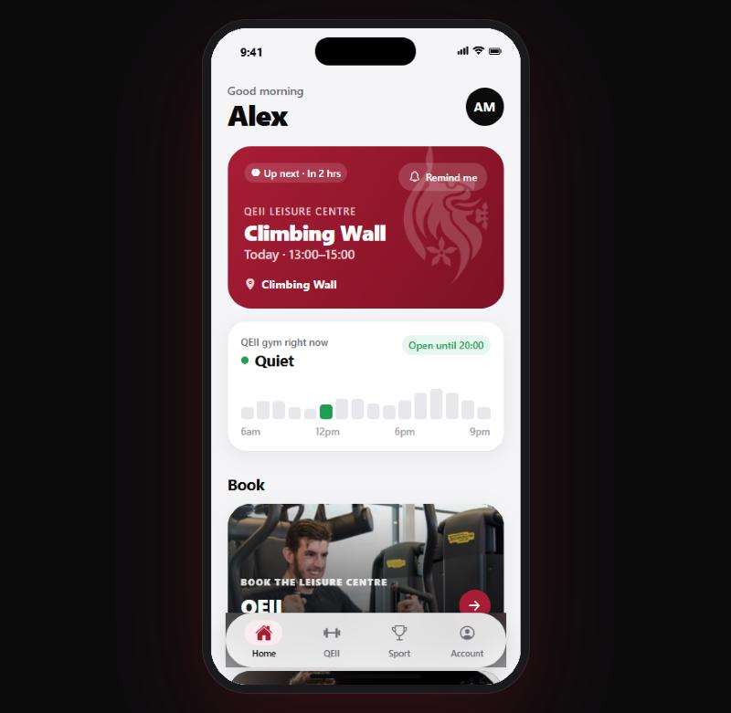 | 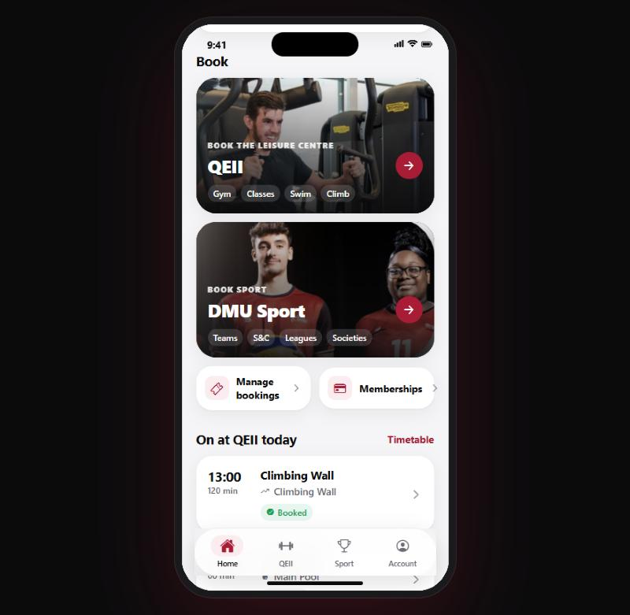 | 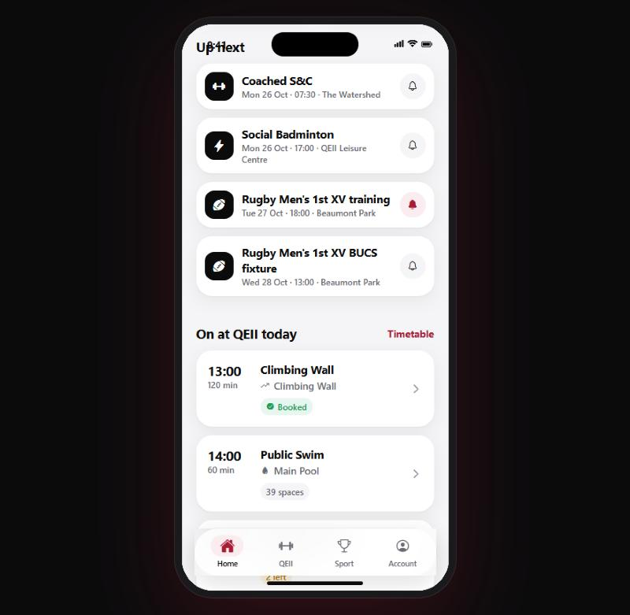 | 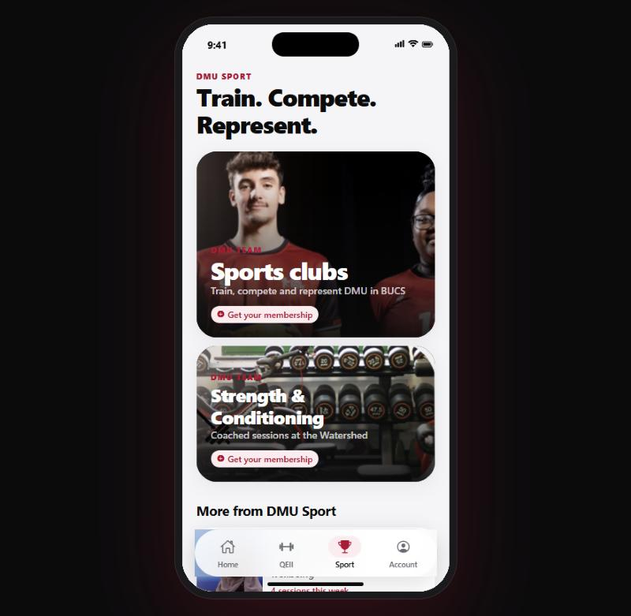 |
| 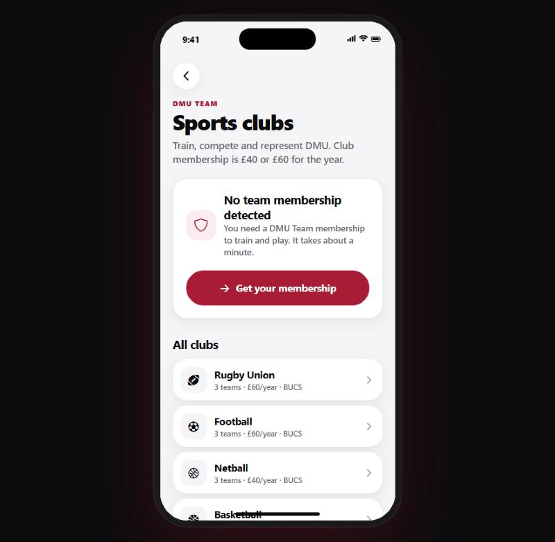 | 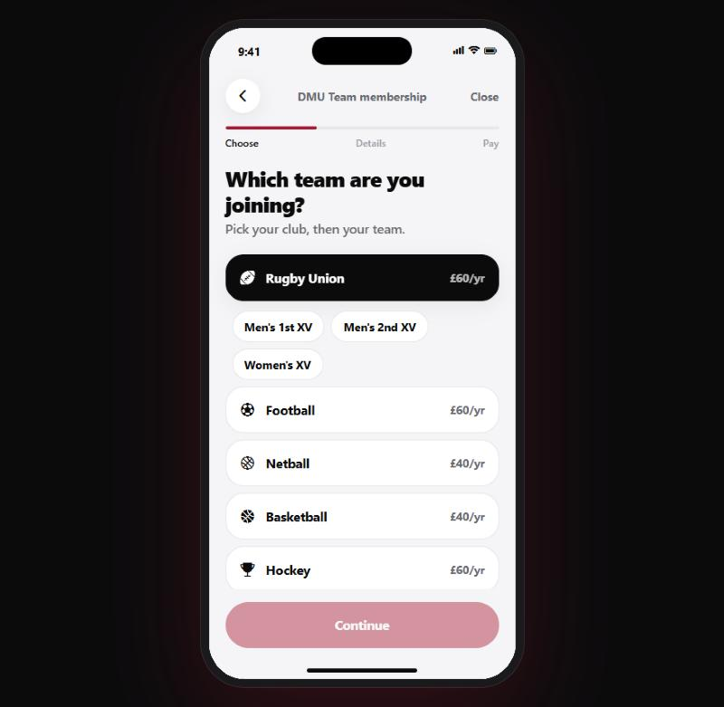 | 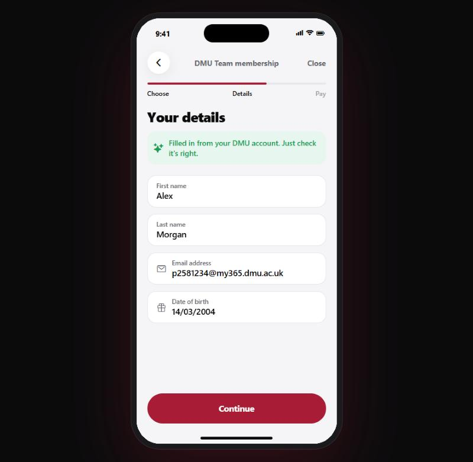 | 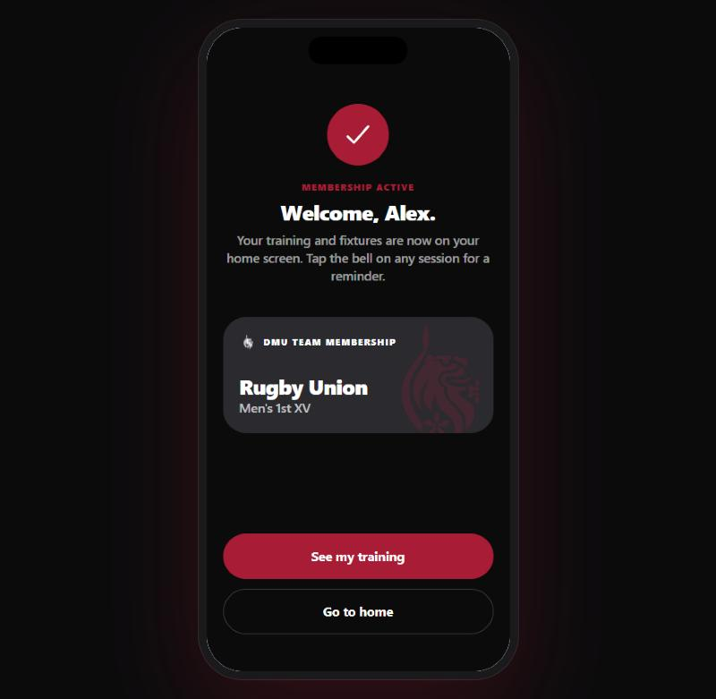 |
| 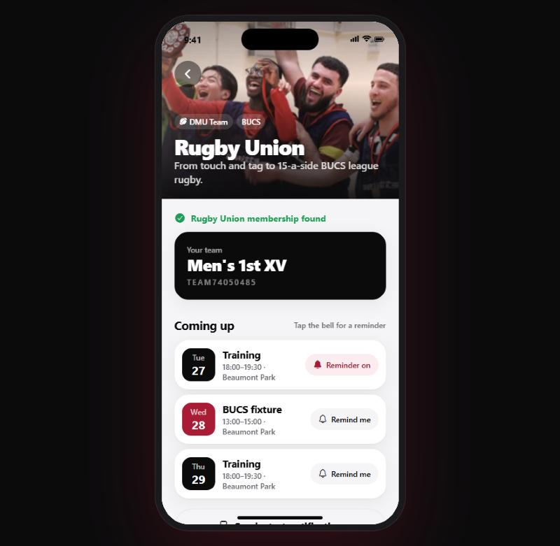 | 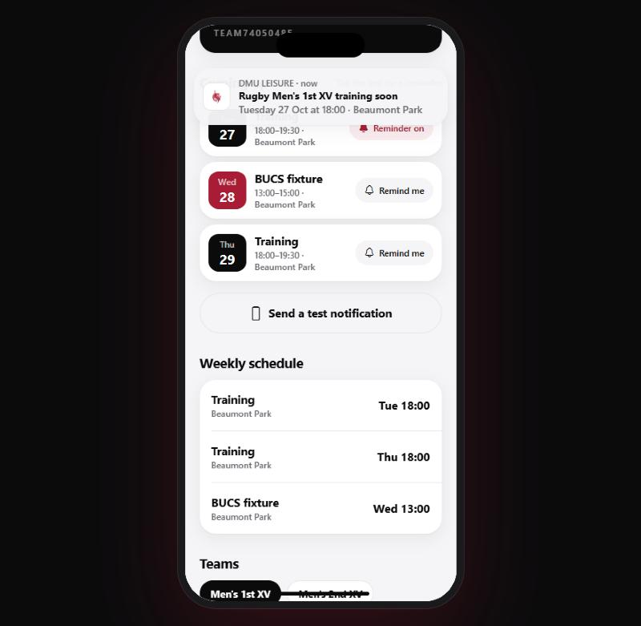 | 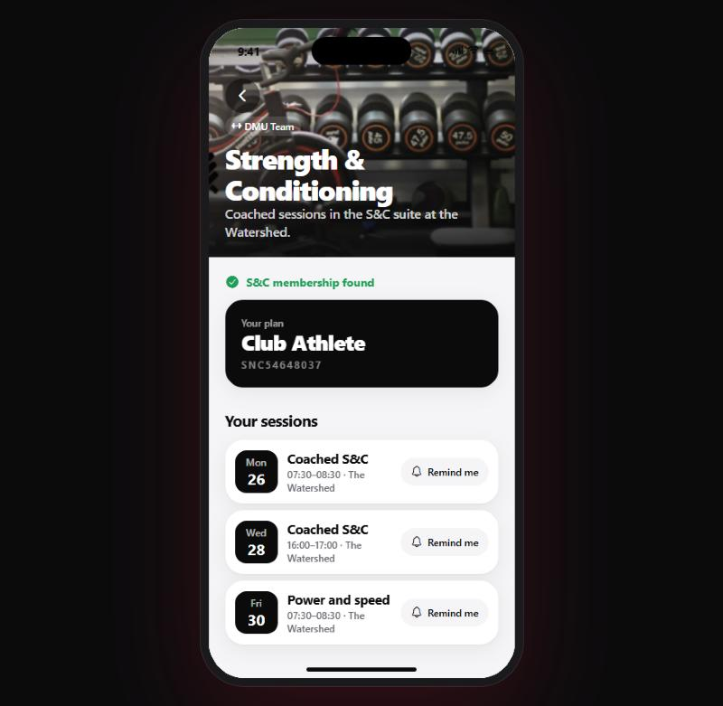 | 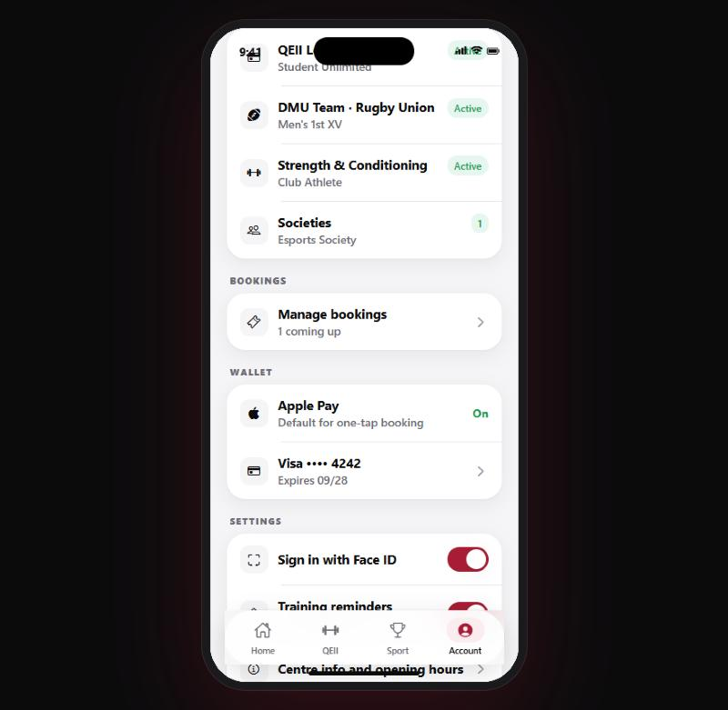 |
| 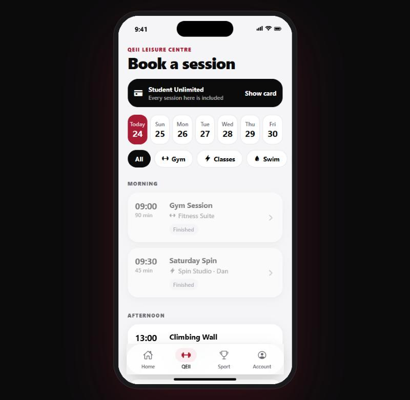 |  | 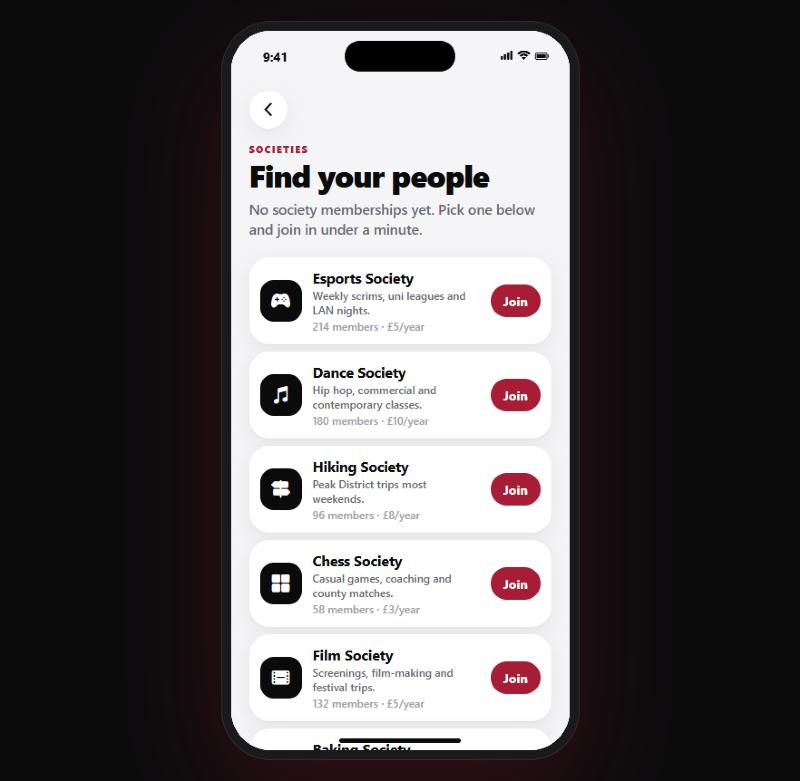 | 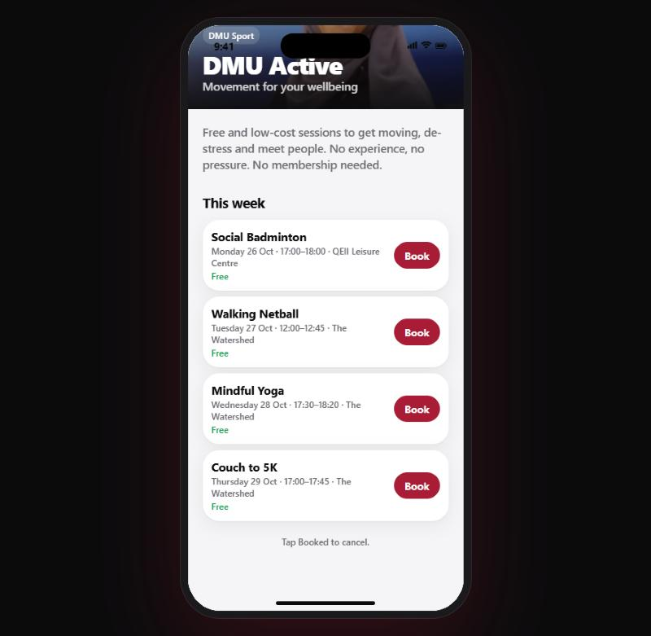 |

## Run it

```bash
npm install
npx expo start
```

- **iPhone:** install Expo Go from the App Store and scan the QR code.
- **Mac iPhone Simulator:** install Xcode, then press `i` in the terminal.
- **Browser (laptop demo):** press `w`. On a wide screen the app sits in an iPhone frame.

## Demo tips

- Any password works on the sign-in screen.
- **Account → Reset demo** wipes bookings, membership and login for a fresh walkthrough.
- A good walkthrough: sign in → Sport → DMU Team ("No membership detected") → Get your membership → Rugby, Men's 1st XV → pay → the training appears in Up next on Home → tap the bell → **Send a test notification** on the club page.
- The test notification fires after 5 seconds. On a phone, lock the screen to see it arrive like a real notification.

## Project layout

- `src/app/` — screens (Expo Router)
- `src/components/` — buttons, form fields, sheets, pay sheet, membership card
- `src/data.ts`: demo QEII timetable, plans and opening hours
- `src/sport.ts`: demo DMU Sport clubs, teams, training times, S&C plans, programmes and societies
- `src/schedule.ts`: builds the Up next list from bookings, team training and S&C
- `src/notify.ts` / `notify.web.ts`: phone and browser reminders
- `src/store.tsx`: login, bookings, memberships, reminders and saved card (kept on the device)
- `src/theme.ts` — colours, type and spacing
