# DMU Leisure — rebuild prototype

A demo-level rebuild of the DMU Leisure app, made to pitch a full rebuild to the De Montfort University board. Built with Expo (React Native) so it runs as a real iPhone app, and in a browser inside an iPhone frame for laptop demos.

Everything runs on demo data. No real payments are taken and nothing connects to DMU's live systems.

## What it fixes

| Complaint about the current app | What this prototype does |
| --- | --- |
| Doesn't remember your login | Sign in once and stay signed in, even after closing the app |
| Re-enter name, address and card on every booking | Details are pre-filled from your DMU account and your card is saved |
| No Apple Pay or quick pay-as-you-go | One-tap Apple Pay–style checkout, or your saved card |
| Crashes and bugs | Small, modern codebase, type-checked and linted |
| Dated, generic template look | DMU red, white and black, with the MyDMU lion |

## Screens

| | | | |
| --- | --- | --- | --- |
| 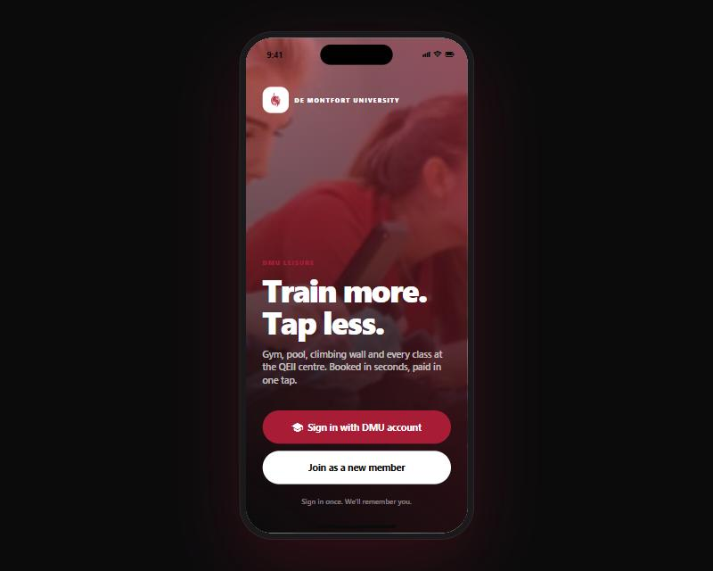 | 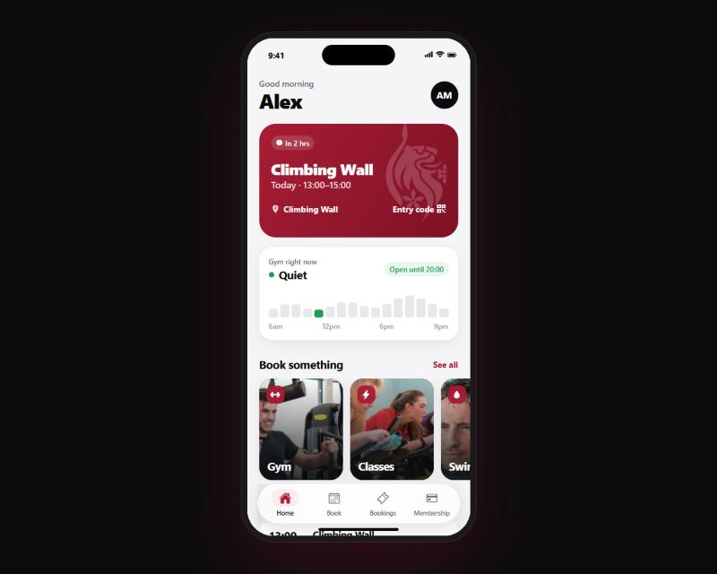 | 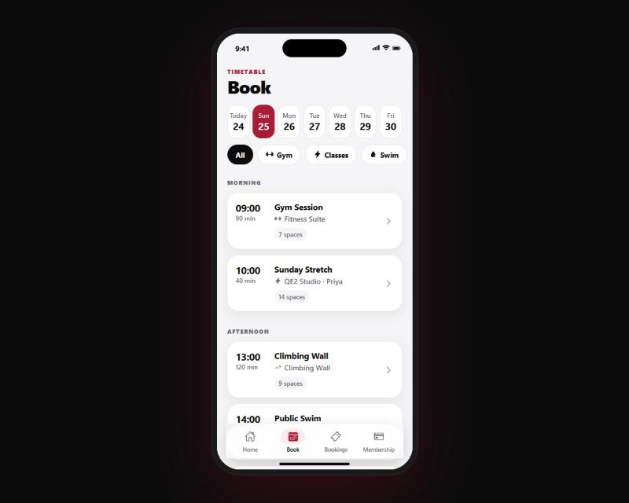 | 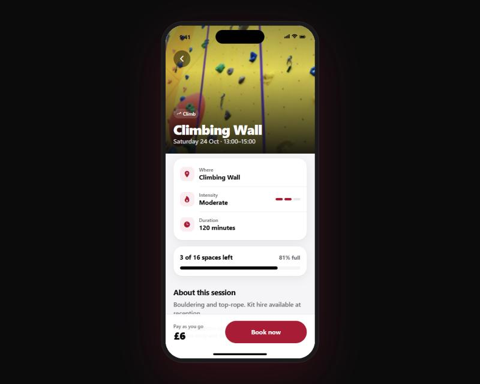 |
| 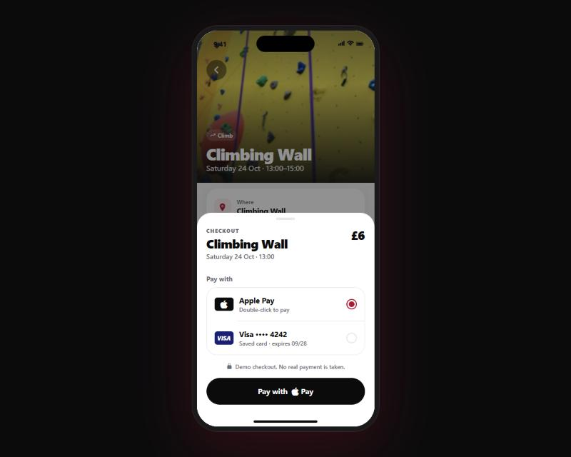 | 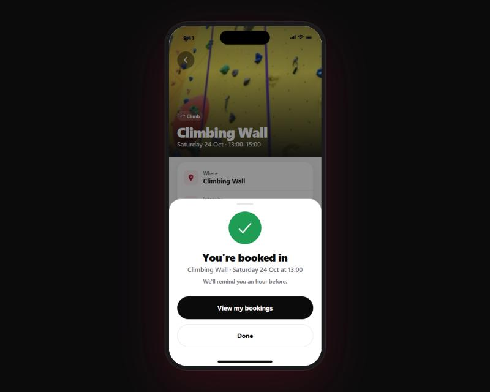 | 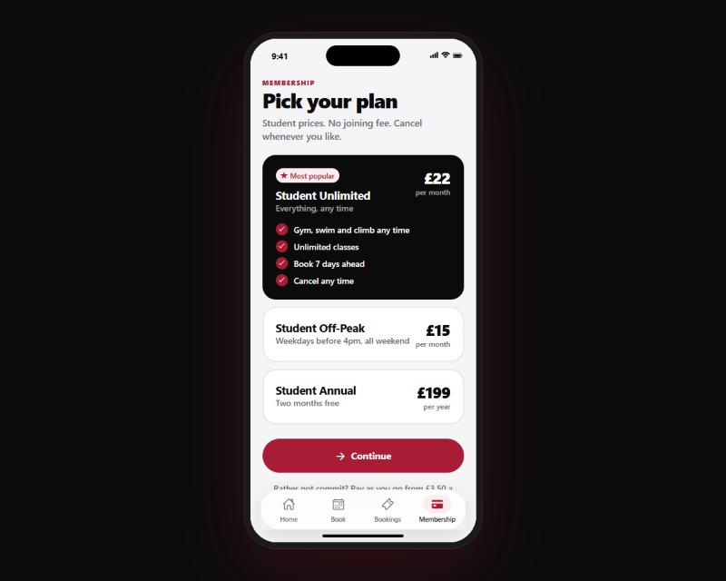 | 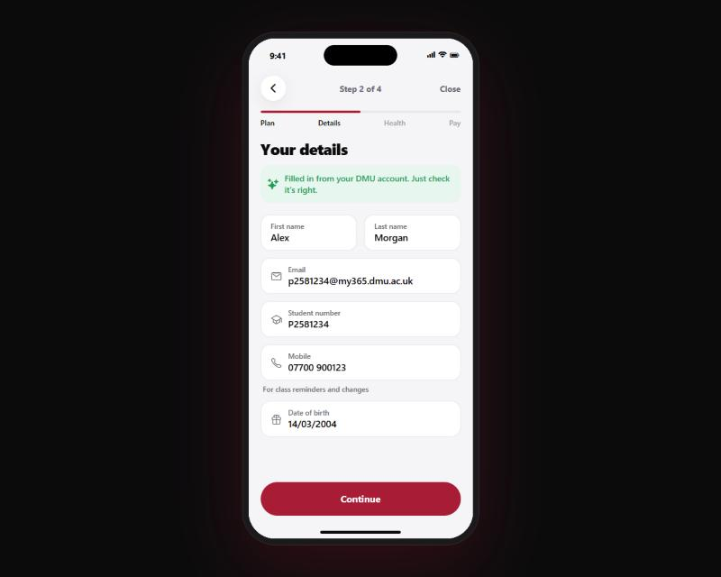 |
| 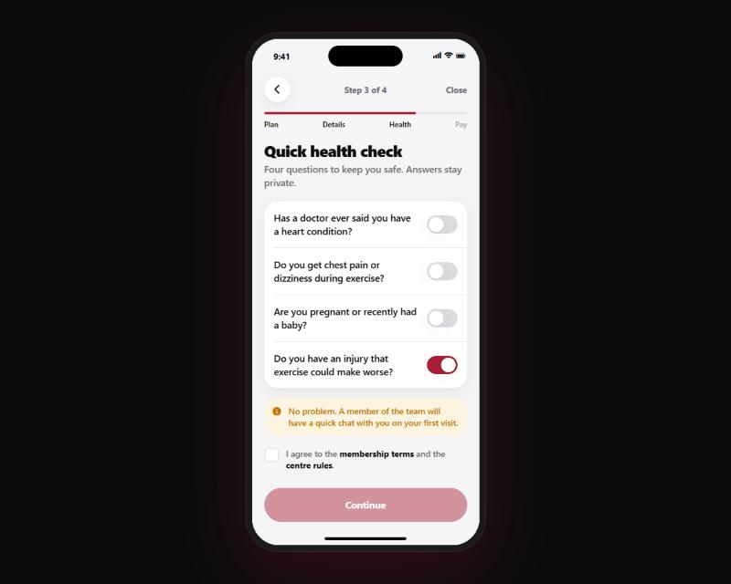 | 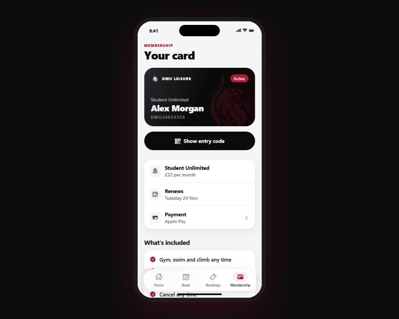 | 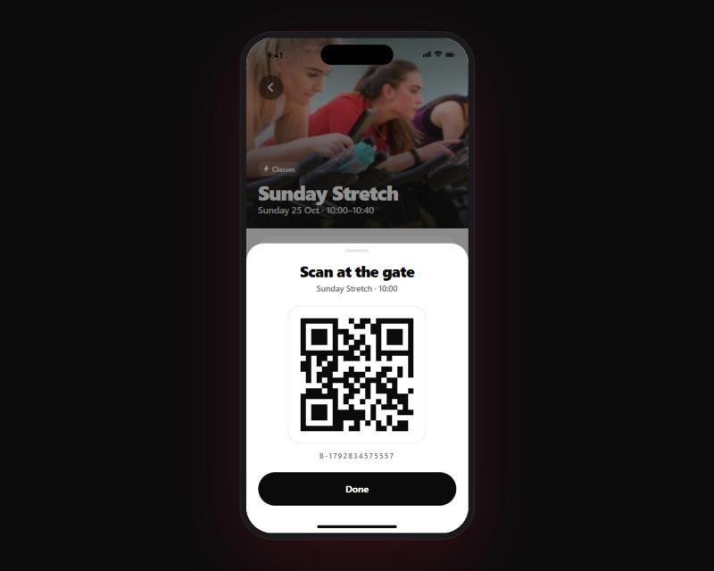 | 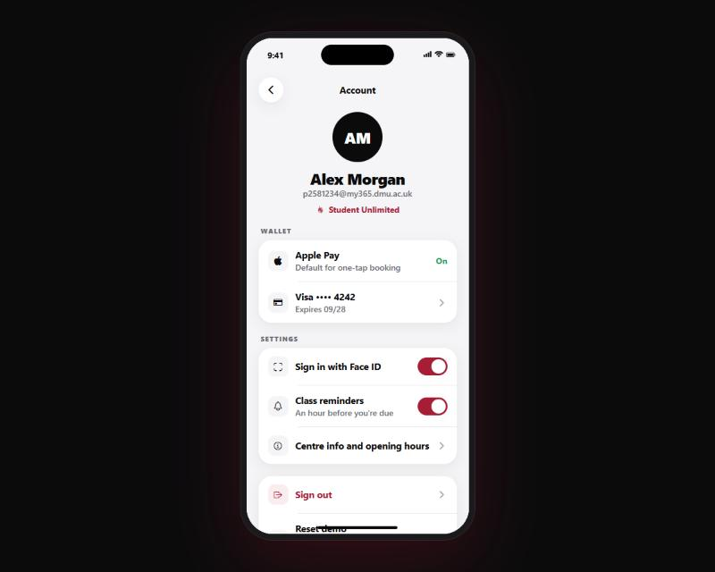 |

## Run it

```bash
npm install
npx expo start
```

- **iPhone:** install Expo Go from the App Store and scan the QR code.
- **Mac iPhone Simulator:** install Xcode, then press `i` in the terminal.
- **Browser (laptop demo):** press `w`. On a wide screen the app sits in an iPhone frame.

## Demo tips

- Any password works on the sign-in screen.
- **Account → Reset demo** wipes bookings, membership and login for a fresh walkthrough.
- A good walkthrough: sign in → book a class with Apple Pay → join Student Unlimited → book another class free → show the entry code.

## Project layout

- `src/app/` — screens (Expo Router)
- `src/components/` — buttons, form fields, sheets, pay sheet, membership card
- `src/data.ts` — demo timetable, plans and opening hours
- `src/store.tsx` — login, bookings, membership and saved card (kept on the device)
- `src/theme.ts` — colours, type and spacing
